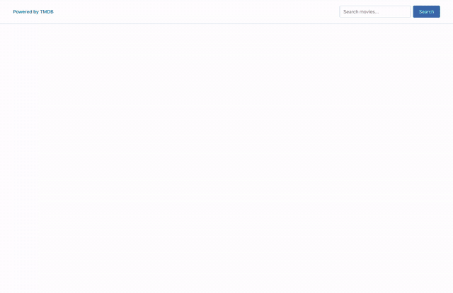
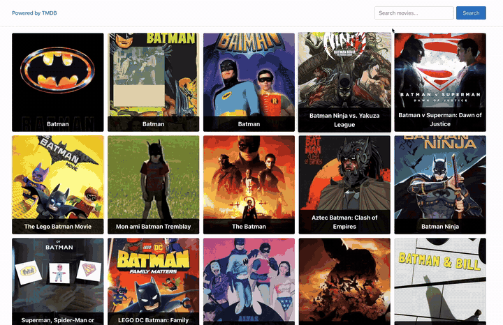
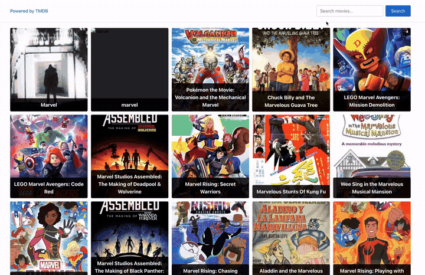
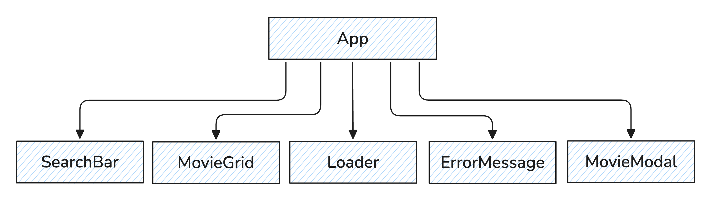

# 🎬 React Movies — TMDB Movie Search

A fully typed React application for searching movies by keyword. It sends HTTP requests to [The Movie Database (TMDB)](https://www.themoviedb.org/) API, renders a responsive grid of posters and opens a modal window with details for the selected movie.

**🔗 Live demo:** [03-react-movies-two-sooty.vercel.app](https://03-react-movies-two-sooty.vercel.app/)<br>
**📦 Repository:** [github.com/mrkorzun/03-react-movies](https://github.com/mrkorzun/03-react-movies)

<p align="center">
  
</p>

---

## Features

- **Keyword search** — the query is sent to the TMDB `search/movie` endpoint; every new search clears the previous results.
- **Form Actions** — the search form is handled with React 19 `<form action>` and `FormData`, no controlled input needed.
- **Input validation** — an empty query shows a toast: _"Please enter your search query."_
- **Empty result handling** — if nothing is found, a toast says _"No movies found for your request."_
- **Loading and error states** — a loader is shown during the request, an error message if it fails.
- **Movie details modal** — rendered through `createPortal`, closes on the **×** button, **Escape** and a backdrop click; page scroll is locked while it's open.
- **Proper cleanup** — closing the modal removes the `keydown` listener, restores body scroll and resets the selected movie.
- **Secure token handling** — the TMDB access token lives in the `VITE_TMDB_TOKEN` environment variable, never in the code.

| Validation                                       | Search                                         |
| ------------------------------------------------ | ---------------------------------------------- |
|    |  |

| Movie modal                                    | No results                                   |
| ---------------------------------------------- | -------------------------------------------- |
|      |  |

## Tech Stack

| Area          | Tools                                                                  |
| ------------- | ---------------------------------------------------------------------- |
| UI            | React 19 (function components, hooks, Form Actions, portals)           |
| Language      | TypeScript 6 (strict mode)                                             |
| HTTP          | Axios, TMDB REST API (Bearer token auth)                               |
| Notifications | `react-hot-toast`                                                      |
| Build         | Vite 8, React Compiler (Babel plugin)                                  |
| Styling       | CSS Modules, `modern-normalize`                                        |
| Code quality  | ESLint (flat config, `typescript-eslint`, React Hooks rules), Prettier |
| Deployment    | Vercel                                                                 |

## Architecture

<p align="center">
  
</p>

The app follows a **"smart container, presentational children"** pattern: all state and side effects live in `App`, child components receive data and callbacks through typed props. HTTP logic is isolated in a service module.

```
App              state: movies, isLoading, isError, selectedMovie
├── SearchBar        form + empty-query validation
├── Loader           while the request is in progress
├── ErrorMessage     if the request failed
├── MovieGrid        poster grid (only when movies.length > 0)
├── MovieModal       portal into document.body (only when a movie is selected)
└── Toaster          react-hot-toast container
```

| Component      | Role                                                      | Props                  |
| -------------- | --------------------------------------------------------- | ---------------------- |
| `App`          | Holds state, runs the search, decides what to render      | —                      |
| `SearchBar`    | Header with the search form, validates the query          | `onSubmit`             |
| `MovieGrid`    | List of movie cards                                       | `movies`, `onSelect`   |
| `Loader`       | "Loading movies, please wait..."                          | —                      |
| `ErrorMessage` | "There was an error, please try again..."                 | —                      |
| `MovieModal`   | Movie details in a portal, ESC/backdrop/× close           | `movie`, `onClose`     |

**Data flow:** form submit → `onSubmit(query)` → `App` clears movies and sets `isLoading` → `fetchMovies(query)` → `movies` updated (or toast / `isError`) → `MovieGrid` re-renders → card click → `onSelect(movie)` → `selectedMovie` → `MovieModal` opens → `onClose()` → `selectedMovie = null`.

### Typing

The movie shape is declared once and reused across components and the service:

```ts
// src/types/movie.ts
export interface Movie {
  id: number;
  poster_path: string;
  backdrop_path: string;
  title: string;
  overview: string;
  release_date: string;
  vote_average: number;
}
```

Component-specific props (`SearchBarProps`, `MovieGridProps`, `MovieModalProps`) are declared next to their components. The Axios response is typed with a `FetchMoviesResponse` interface, so `response.data.results` is known to be `Movie[]` at compile time.

### HTTP service

```ts
// src/services/movieService.ts
const { data } = await axios.get<FetchMoviesResponse>(
  "https://api.themoviedb.org/3/search/movie",
  {
    params: { query },
    headers: {
      Authorization: `Bearer ${import.meta.env.VITE_TMDB_TOKEN}`,
    },
  },
);
return data.results;
```

Image URLs are built from TMDB paths: `https://image.tmdb.org/t/p/w500{poster_path}` for the grid and `https://image.tmdb.org/t/p/original{backdrop_path}` for the modal.

## Project Structure

```
src/
├── components/
│   ├── App/            App.tsx, App.module.css
│   ├── SearchBar/      SearchBar.tsx, SearchBar.module.css
│   ├── MovieGrid/      MovieGrid.tsx, MovieGrid.module.css
│   ├── Loader/         Loader.tsx, Loader.module.css
│   ├── ErrorMessage/   ErrorMessage.tsx, ErrorMessage.module.css
│   └── MovieModal/     MovieModal.tsx, MovieModal.module.css
├── services/
│   └── movieService.ts fetchMovies (Axios + TMDB)
├── types/
│   └── movie.ts        shared Movie interface
└── main.tsx            entry point
```

Each component is self-contained: its markup, logic and scoped styles live in one folder, which makes components easy to move, reuse or delete.

## Getting Started

**Requirements:** Node.js 20+, npm and a free [TMDB](https://www.themoviedb.org/signup) account.

1. Get your **API Read Access Token** in TMDB → Settings → API.
2. Clone and install:

   ```bash
   git clone https://github.com/mrkorzun/03-react-movies.git
   cd 03-react-movies
   npm install
   ```

3. Create a `.env` file in the project root (it's ignored by Git):

   ```bash
   VITE_TMDB_TOKEN=your_tmdb_read_access_token
   ```

4. Start the dev server:

   ```bash
   npm run dev
   ```

| Command           | Description                                    |
| ----------------- | ---------------------------------------------- |
| `npm run dev`     | Start the dev server with HMR                  |
| `npm run build`   | Type-check (`tsc -b`) and build for production |
| `npm run preview` | Preview the production build locally           |
| `npm run lint`    | Run ESLint                                     |

> For deployment on Vercel, add `VITE_TMDB_TOKEN` in **Project Settings → Environment Variables**.

## What This Project Demonstrates

- Working with a real REST API: Axios, query params, Bearer token authorization
- Keeping secrets out of the code with Vite environment variables
- Typing API responses and service functions with TypeScript generics
- `async/await` with `try/catch/finally` for loading and error states
- React 19 Form Actions and `FormData`
- Multiple pieces of state and conditional rendering
- User feedback with toast notifications
- Modals via `createPortal`, keyboard handling and `useEffect` cleanup
- Scoped styling with CSS Modules
- Clean tooling setup (Vite, ESLint, Prettier) and deployment to Vercel

## Author

**Romario Korzun** — Fullstack Developer (in training, GoIT Fullstack Bootcamp)
GitHub: [@mrkorzun](https://github.com/mrkorzun)

---

_Built as part of the GoIT Fullstack Developer program. Design and base styles were provided by GoIT ([react-movies-styles](https://github.com/goitacademy/react-movies-styles)); component logic, HTTP requests, state management and typing were implemented by the author._
